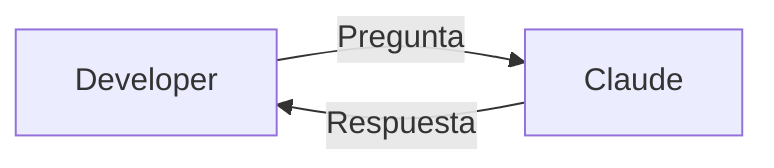
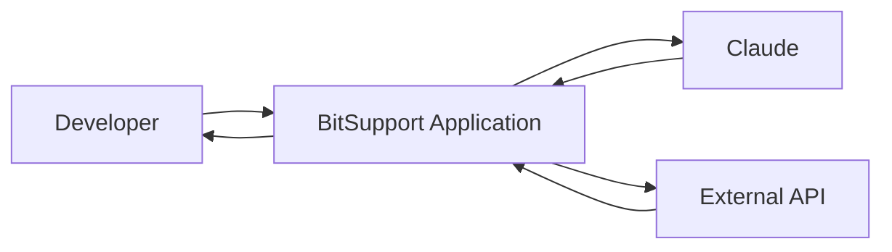
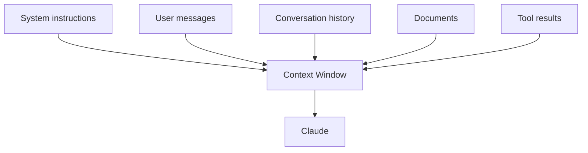
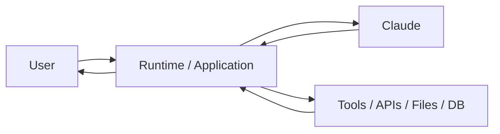
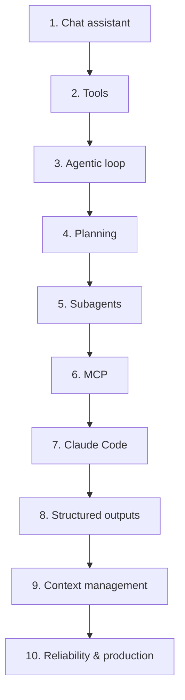

# Capítulo 0 — Antes de empezar: el mapa mínimo para entender Claude

[← Volver al inicio](../README.md) · [Roadmap](../ROADMAP.md) · [Siguiente: el examen CCAR-F →](../01-exam-overview/README.md)

---

Imaginemos que mañana tu equipo recibe este pedido:

> “Queremos un asistente interno que ayude a los developers cuando tienen una duda técnica. Que pueda responder preguntas, consultar documentación, revisar el estado de herramientas internas y, más adelante, ayudar a investigar problemas.”

A ese asistente lo vamos a llamar **BitSupport**.

Todavía no vamos a construirlo. Primero necesitamos entender cuáles son las piezas que existirían debajo.

Si ya trabajás con APIs, JSON y backend services, varias cosas de este capítulo te van a resultar conocidas. Leelo igual: no buscamos enseñarte HTTP desde cero, sino acordar el **mental model** que vamos a usar durante todo el libro.

---

# 1. Empecemos por el centro: el LLM

Claude es un **Large Language Model (LLM)**.

Para este libro no necesitamos empezar estudiando transformers, matrices ni entrenamiento. Nos alcanza con una idea mucho más práctica:

> un LLM recibe información de entrada y genera una salida en función de ese contexto.

Si BitSupport fuera solamente un LLM, la interacción más simple sería:



Por ejemplo:

> **Developer:** “¿Qué significa HTTP 502?”

Claude puede responder porque ese conocimiento puede estar representado en el modelo y porque la pregunta no requiere interactuar con ningún sistema de tu empresa.

Pero ahora cambia la pregunta:

> **Developer:** “¿Falló hoy el último deploy de payments-api?”

Acá aparece nuestro primer límite importante.

Claude puede **explicar qué significa un deploy fallido**, pero no puede conocer mágicamente el estado actual de tu CI/CD.

Necesita acceso a información externa.

Esta pequeña diferencia —entre **generar una respuesta** y **observar el mundo real**— va a ser central durante toda la certificación.

---

# 2. ¿Qué es una API y por qué nos importa?

Una **API (Application Programming Interface)** es un contrato para que dos programas puedan comunicarse.

En nuestro ejemplo, tal vez Jenkins, GitHub o una plataforma interna exponga algo parecido a:

```text
GET /deployments/payments-api/latest
```

y responda:

```json
{
  "service": "payments-api",
  "status": "failed",
  "finished_at": "2026-10-11T14:22:00Z"
}
```

BitSupport necesitaría alguna pieza de software capaz de realizar esa llamada.

El esquema general empieza a crecer:



Fijate en algo importante: **Claude y la aplicación no son la misma cosa**.

Claude aporta model capabilities.

La aplicación aporta control, integración y ejecución.

Esta separación va a aparecer una y otra vez.

---

# 3. JSON: el idioma práctico de muchas integraciones

Las APIs modernas suelen intercambiar datos estructurados en **JSON**.

Ejemplo:

```json
{
  "service": "payments-api",
  "environment": "qa",
  "status": "failed"
}
```

Para una persona, esto es fácil de leer.

Para una aplicación, además, tiene una ventaja enorme: la estructura puede validarse.

Podemos decir:

- `service` debe ser string;
- `environment` debe pertenecer a ciertos valores;
- `status` debe ser uno de `success | failed | running`.

Ahí aparece otro término que vamos a usar muchísimo.

---

# 4. Schema: no alcanza con “devolver JSON”

Un **schema** describe qué forma deben tener los datos.

Imaginemos que BitSupport necesita consultar un deploy.

Podríamos definir que la entrada esperada sea:

```json
{
  "service": "payments-api",
  "environment": "qa"
}
```

y que:

- ambos campos sean required;
- `environment` sólo admita ciertos valores;
- no se permita inventar campos adicionales.

¿Por qué importa?

Porque un AI system combina dos mundos:

```text
probabilistic model
+
deterministic software
```

El model es flexible.

El software necesita contratos.

Los schemas son uno de los puentes entre esos mundos.

Más adelante vamos a ver que esto es fundamental para:

- **tool input schemas**;
- **structured outputs**;
- validation;
- reliability.

---

## 💭 Pensalo antes de seguir

Si Claude responde:

```text
"El deploy parece haber fallado."
```

¿eso es equivalente a recibir:

```json
{
  "status": "failed"
}
```

<details>
<summary>Ver respuesta</summary>

No.

El texto puede ser útil para una persona, pero el JSON tiene una estructura que otra parte del sistema puede validar y procesar de manera determinista.

Ésta es una de las razones por las que los **structured outputs** son importantes en arquitectura.

</details>

---

# 5. ¿Qué es un token?

Los modelos no trabajan internamente con “palabras” exactamente como las vemos nosotros.

El texto se representa mediante unidades llamadas **tokens**.

No necesitamos memorizar cómo se tokeniza cada frase. Lo importante es entender que los tokens tienen consecuencias prácticas.

Más tokens implican potencialmente:

- más context consumption;
- mayor cost;
- mayor latency;
- menos espacio disponible dentro del context window.

Cuando un agent empieza a:

- acumular conversation history;
- incluir documentos;
- recibir tool results;
- mantener instrucciones;
- trabajar durante muchos turns;

el uso del context se vuelve una decisión arquitectónica.

Por eso este concepto que ahora parece básico volverá con mucha fuerza en **Domain 5 — Context Management & Reliability**.

---

# 6. Context window: la mesa de trabajo del modelo

Una forma intuitiva de imaginar el **context window** es pensar en una mesa.

Claude sólo puede razonar con lo que tiene disponible sobre esa mesa durante la inferencia actual.

Puede haber:

- system instructions;
- mensajes del usuario;
- mensajes anteriores;
- documentos;
- tool definitions;
- tool results;
- otros datos inyectados por la aplicación.



La analogía tiene un límite, pero sirve para construir intuición.

Si llenamos la mesa con cosas irrelevantes, Claude tiene más información que procesar y menos espacio para lo importante.

Más adelante aprenderemos técnicas para manejar esto.

---

# 7. Application state no es lo mismo que model context

Este punto evita muchas confusiones.

Supongamos que BitSupport guarda en una database:

```text
incident_id = INC-4821
assigned_team = Platform
status = investigating
```

Eso es **application state**.

Claude no conoce automáticamente esa información.

Para usarla, la aplicación necesita:

1. recuperarla;
2. incluirla en el contexto o devolverla mediante una tool;
3. permitir que el model razone con ella.

Por eso no conviene decir simplemente:

> “Claude tiene memoria”.

Hay que preguntar:

> **¿dónde está almacenado el estado y cómo vuelve al contexto?**

---

# 8. El Runtime: la pieza que hace que las decisiones se conviertan en acciones

Llegamos a una palabra que usaremos mucho: **runtime**.

En esta guía llamaremos runtime a la capa de software que rodea al model y se encarga de cosas como:

- realizar API calls;
- ejecutar tools;
- mantener state;
- aplicar permisos;
- validar outputs;
- manejar errors;
- imponer limits;
- volver a llamar al model.

Visualmente:



Esto nos prepara para una idea que veremos en el próximo capítulo técnico:

> Claude puede **decidir** que necesita una acción, pero alguna capa tiene que **ejecutarla**.

---

# 9. Tool: una capacidad que el model puede pedir utilizar

Una **tool** es una capacidad expuesta al model.

Por ejemplo, BitSupport podría tener:

```text
get_deployment_status
get_incident
search_internal_docs
get_service_owner
```

Cada tool representa una acción disponible.

Todavía no nos interesa la implementación exacta. Nos interesa distinguir dos ideas:

### Capability

La tool define algo que el system puede hacer.

### Execution

El runtime es responsable de ejecutar esa capability cuando corresponda.

En el capítulo 2 vamos a seguir exactamente desde acá y veremos cómo aparece `tool_use`.

---

# 10. Nuestro laboratorio: qué vamos a construir

BitSupport será un proyecto progresivo.

No vamos a escribir todo ahora.

Cada capítulo agregará una capacidad nueva.



El valor del laboratorio no es crear “el mejor producto posible”.

Es tener un mismo sistema donde podamos ver cómo cada concepto modifica una arquitectura real.

👉 [Abrir BitSupport Lab](../lab-bit-support/README.md)

---

# 11. 🧪 Probalo vos — leer datos estructurados

Antes de usar Claude, hagamos una tarea puramente de software.

Creá un archivo `deployment.json`:

```json
{
  "service": "payments-api",
  "environment": "qa",
  "status": "failed"
}
```

Y un script Python:

```python
import json

with open("deployment.json", encoding="utf-8") as file:
    deployment = json.load(file)

print(
    f"{deployment['service']} en "
    f"{deployment['environment']}: "
    f"{deployment['status']}"
)
```

¿Qué estamos demostrando?

Que cuando la información viene estructurada, el programa puede trabajar con ella sin tener que “interpretar” lenguaje natural.

Más adelante combinaremos justamente estas dos capacidades:

```text
Claude
→ entiende intención

Python/runtime
→ aplica contratos y ejecuta acciones
```

---

# 12. 🧩 Challenge

Tu equipo quiere que BitSupport responda:

> “¿Quién es el owner actual de payments-api?”

Sabemos que ese dato vive en un catálogo interno y puede cambiar.

¿Cuál de estas estrategias es conceptualmente mejor?

A. Pedirle a Claude que recuerde el owner por conocimiento general.  
B. Incluir siempre toda la database de ownership en cada prompt.  
C. Darle al sistema una forma controlada de consultar el dato actual cuando lo necesita.  
D. Aumentar temperature para que encuentre una respuesta.

<details>
<summary>Ver respuesta</summary>

**C**.

La pregunta depende de información externa, mutable y específica de la organización.

A falla porque el model no tiene por qué conocer el dato actual.

B puede funcionar en sistemas muy pequeños, pero escala mal y desperdicia context.

D cambia sampling behavior; no proporciona acceso a la información correcta.

Lo que estamos preparando conceptualmente es el uso de **tools/retrieval**.

</details>

---

# 13. Summary — la película completa

Empezamos con una pregunta sencilla: ¿qué tendría que existir debajo de un asistente técnico como BitSupport?

Primero apareció el **LLM**: recibe contexto y genera output.

Después vimos su primera limitación práctica: generar texto no equivale a observar sistemas externos.

Para conectarnos con esos sistemas necesitamos software tradicional: **APIs**, datos estructurados como **JSON** y contratos como **schemas**.

También entendimos que Claude sólo puede razonar con la información disponible en su **context window**, mientras que el estado durable puede vivir fuera, en nuestra propia aplicación.

Finalmente apareció la pieza que va a unir todo en los próximos capítulos: el **runtime**.

El runtime rodea al model, conecta sistemas, ejecuta acciones y aplica controles.

Con eso ya podemos dibujar nuestro primer mental model completo:

```text
User
  ↓
Application / Runtime
  ↓
Claude
  ↓
decision or output

Application / Runtime
  ↕
APIs / DB / Files / Tools
```

Todavía no construimos un agent.

Pero ya tenemos todas las piezas necesarias para entender **por qué un LLM solo no lo es**.

Y ése es exactamente el punto de partida del capítulo 2.

---

# 14. Preguntas finales

### 1. ¿Claude y tu application son la misma capa?

<details>
<summary>Ver respuesta</summary>

No.

Claude aporta model capabilities. La application/runtime administra integración, state, ejecución y controles alrededor del model.

</details>

### 2. ¿Dónde vive necesariamente la información persistente?

<details>
<summary>Ver respuesta</summary>

No necesariamente dentro del model context.

Puede vivir en databases, files, memory stores u otros sistemas. La aplicación decide cuándo recuperarla e incorporarla al contexto.

</details>

### 3. ¿Por qué un schema es importante en AI systems?

<details>
<summary>Ver respuesta</summary>

Porque permite establecer contratos deterministas sobre datos que entran o salen de componentes probabilísticos.

Más adelante esto será especialmente importante para tools y structured outputs.

</details>

### 4. ¿Qué función conceptual cumple el runtime?

<details>
<summary>Ver respuesta</summary>

Es la capa que conecta el model con el resto del sistema: ejecuta actions/tools, administra state, maneja errors, aplica limits y devuelve resultados al model.

</details>

---

# Seguir

Ya tenemos el vocabulario mínimo.

Antes de entrar en agents, conviene entender exactamente qué certificación estamos preparando y qué tipo de razonamiento intenta medir.

### 👉 [Capítulo 1 — El examen CCAR-F](../01-exam-overview/README.md)
