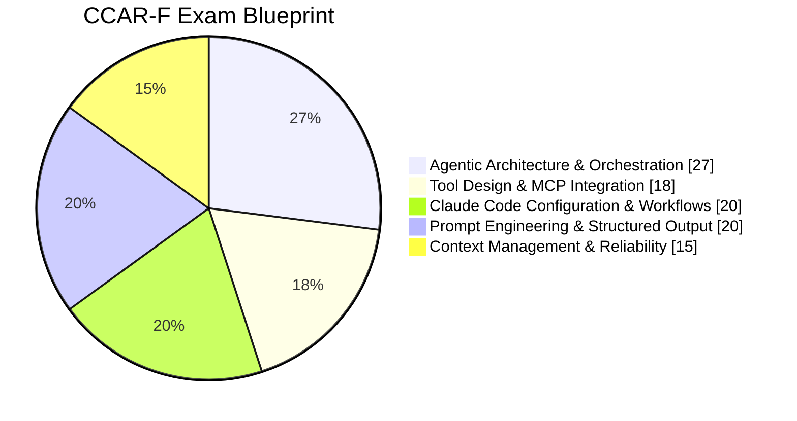
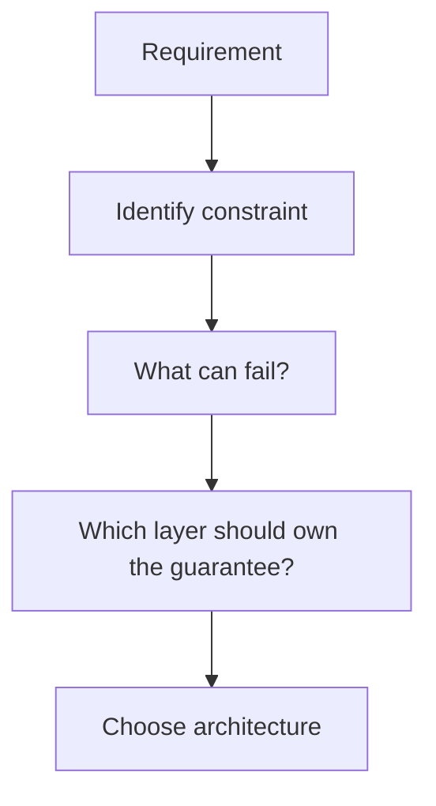
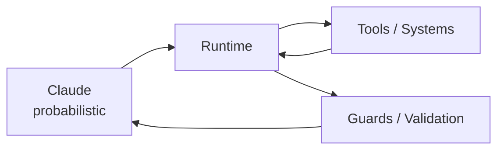

# Capítulo 1 — El examen CCAR-F: entender qué estamos preparando

[← Capítulo 0](../00-prerequisites/README.md) · [Roadmap](../ROADMAP.md) · [Siguiente: De un LLM a un Agent →](../02-agentic-architecture-foundations/README.md)

---

Antes de estudiar agents, MCP o Claude Code, conviene responder una pregunta mucho más básica:

> **¿Qué intenta comprobar realmente CCAR-F?**

Si entendemos mal esa pregunta, podemos pasar semanas memorizando conceptos y aun así llegar mal preparados.

CCAR-F no está diseñado como un examen donde alcanza con recordar definiciones.

La mayoría de las decisiones aparecen dentro de **scenarios**: situaciones de arquitectura donde varias respuestas pueden parecer razonables, pero una encaja mejor con los requirements, los constraints y los trade-offs.

Por eso nuestra preparación va a tener dos capas desde el comienzo:

```text
entender el concepto
+
saber decidir cuándo usarlo
```

---

# 1. Qué es CCAR-F

**Claude Certified Architect – Foundations (CCAR-F)** valida conocimientos de arquitectura alrededor de Claude.

Las áreas centrales incluyen:

- Claude API;
- Claude Agent SDK;
- Claude Code;
- Model Context Protocol (**MCP**);
- agentic architecture;
- tools;
- prompting;
- structured outputs;
- context management;
- reliability.

La palabra importante es **Architect**.

No significa que el examen ignore implementación. De hecho, hay muchos detalles técnicos.

Significa que esos detalles suelen evaluarse dentro de una pregunta mayor:

> “Dadas estas restricciones, ¿cuál es la mejor decisión de diseño?”

---

# 2. Cómo es el examen

Con la información oficial vigente utilizada por esta guía:

| Dato | Valor |
|---|---|
| Exam code | **CCAR-F** |
| Items | **60** |
| Tiempo | **120 minutos** |
| Formato | **multiple-choice** y **multiple-response** |
| Idioma | **English** |
| Scenarios por examen | **4** |
| Scenario bank publicado | **6** |
| Passing score | **720** |
| Score scale | **100–1000** |
| Precio de lista | **USD 125 por intento** |
| Entrega | online proctored / Pearson VUE test center |
| Validez indicada | **12 meses** |

Dos horas para 60 items equivale, como promedio, a unos dos minutos por pregunta.

Eso no significa que debas cronometrar exactamente dos minutos cada una. Significa que necesitás reconocer patrones y trade-offs con suficiente soltura como para no reconstruir toda la teoría desde cero en cada item.

---

## 🔴 EXAM CRITICAL — 720/1000 no significa 72%

El resultado utiliza **scaled scoring**.

Por eso:

```text
720 / 1000
≠
72% de respuestas correctas
```

No uses resultados de mocks como una conversión matemática directa al score oficial.

Los mocks nos van a servir para:

- detectar gaps;
- medir consistencia;
- entrenar timing;
- practicar escenarios ambiguos.

No para predecir exactamente el scaled score.

---

# 3. El blueprint: nuestro verdadero mapa

El examen se divide en cinco domains.



| Domain | Weight |
|---|---:|
| **1. Agentic Architecture & Orchestration** | **27%** |
| **2. Tool Design & MCP Integration** | **18%** |
| **3. Claude Code Configuration & Workflows** | **20%** |
| **4. Prompt Engineering & Structured Output** | **20%** |
| **5. Context Management & Reliability** | **15%** |

En total trabajaremos **30 task statements**.

Ese número es importante porque nuestro objetivo final no será:

> “terminé el curso”.

Será:

> **“puedo explicar, aplicar y defender decisiones sobre los 30 task statements.”**

👉 El tracking vive en [BLUEPRINT_COVERAGE.md](../BLUEPRINT_COVERAGE.md).

---

# 4. Por qué Agentic Architecture pesa tanto

El domain de mayor peso es:

> **Agentic Architecture & Orchestration — 27%**

Esto tiene sentido si pensamos qué significa construir una aplicación moderna con Claude.

Muy pronto aparecen preguntas como:

- ¿workflow o agent?
- ¿cómo dividir una tarea compleja?
- ¿cuándo conviene un subagent?
- ¿qué información debe recibir?
- ¿cómo se maneja un handoff?
- ¿qué pasa si una tool falla?
- ¿cuándo retry y cuándo escalation?
- ¿cómo se evita que un agent siga ejecutándose indefinidamente?

Por eso nuestro primer bloque técnico empieza precisamente ahí.

---

# 5. Los scenarios: por qué el examen se siente diferente a un quiz común

El Exam Guide publica un banco de seis scenarios:

1. **Customer Support Resolution Agent**
2. **Code Generation with Claude Code**
3. **Multi-Agent Research System**
4. **Developer Productivity with Claude**
5. **Claude Code for Continuous Integration**
6. **Structured Data Extraction**

Cada exam form utiliza cuatro.

No significa que tengas que memorizar seis historias.

Significa que los conceptos aparecen **dentro de sistemas reales**.

Por ejemplo, una pregunta podría describir un support agent que:

- consulta customer data;
- llama varias tools;
- puede modificar un pedido;
- debe escalar ciertos casos a una persona.

Y después preguntarte cuál es la mejor arquitectura para evitar acciones incorrectas.

La respuesta no sale de memorizar:

> “Human-in-the-loop = definición X”.

Sale de entender por qué un sistema con side effects necesita boundaries y review points.

---

# 6. Cómo leer una pregunta de arquitectura

Imaginemos este scenario:

> Un agent procesa tareas de soporte. Por seguridad, nunca debe ejecutar más de diez iterations por solicitud.

¿Qué señales aparecen?

### Requirement

Nunca superar diez iterations.

### Tipo de constraint

Es un **hard invariant**.

### Pregunta arquitectónica

¿Dónde debería enforced?

Ahora consideremos cuatro alternativas:

A. escribir en el system prompt “no hagas más de diez iterations”;  
B. pedirle al model que cuente sus turns;  
C. imponer el límite programáticamente en el runtime/orchestrator;  
D. reducir temperature.

Aunque A pueda ayudar al comportamiento, no garantiza el requirement.

C sí.

La forma de pensar fue:



Éste es el tipo de razonamiento que vamos a entrenar durante todo el libro.

---

# 7. Una idea que vas a ver muchas veces

Guardá este principio porque aparecerá de diferentes formas:

> **Probabilistic intelligence + deterministic control**

Claude es especialmente bueno para tareas como:

- reasoning;
- classification;
- planning;
- synthesis;
- understanding ambiguous language;
- deciding dynamically entre alternativas.

El software tradicional sigue siendo mejor para garantías como:

- maximum turns;
- permissions;
- schema validation;
- authorization;
- exact business rules;
- retry limits;
- deterministic checks.



El examen no suele premiar “usar más AI”.

Suele premiar **poner cada responsabilidad en la capa correcta**.

---

# 8. Cómo vamos a estudiar

Cada capítulo va a repetir un ciclo:

```text
entender
↓
ver un ejemplo
↓
aplicarlo a BitSupport
↓
tomar una decisión
↓
probarlo
↓
revisar failure modes
↓
conectarlo con CCAR-F
```

Esto evita un problema común: reconocer una definición cuando la vemos, pero no saber usarla en un scenario.

---

## 💭 Pensalo antes de seguir

¿Cuál de estas dos frases describe mejor lo que necesitamos para CCAR-F?

A. “Puedo definir qué es un agent.”  
B. “Puedo reconocer cuándo usar un agent, cuándo un workflow es mejor y qué controles necesita cada uno.”

<details>
<summary>Ver respuesta</summary>

**B**.

Saber la definición es necesario, pero el examen apunta a decisiones contextualizadas.

Una buena preparación transforma conocimiento declarativo en **architectural judgment**.

</details>

---

# 9. El laboratorio también sigue el blueprint

BitSupport no es un proyecto separado del estudio.

Lo vamos a usar para que los domains se encuentren en un mismo sistema.

Por ejemplo:

```text
Agentic Architecture
→ decide cómo trabaja BitSupport

Tool Design & MCP
→ decide cómo accede a capacidades externas

Claude Code
→ introduce workflows de software engineering

Prompt Engineering
→ define instrucciones y outputs confiables

Context Management
→ mantiene información útil sin degradar el sistema
```

Cuando terminemos, vas a haber visto los mismos conceptos:

- en teoría;
- en diagrams;
- en código;
- en architectural decisions;
- en exam-style questions.

---

# 10. Estrategia de tiempo durante el examen

Todavía no necesitamos una estrategia rígida, pero sí una regla práctica.

Cuando una pregunta sea ambigua:

1. identificá el requirement principal;
2. separá hard constraints de preferences;
3. buscá el failure mode que el scenario intenta evitar;
4. descartá opciones que agregan complexity sin necesidad;
5. elegí la alternativa más simple que cumpla de forma confiable.

No te enamores de la tecnología más avanzada de las opciones.

Muchas preguntas de arquitectura se resuelven reconociendo cuándo **no** hace falta complejidad.

---

# 11. 🧩 Challenge — la opción más sofisticada no siempre gana

Un equipo procesa documentos siempre con el mismo formato.

El flujo es:

```text
extract
→ validate
→ transform
→ save
```

Los pasos son conocidos y el output tiene un schema fijo.

El equipo propone reemplazarlo por un autonomous agent para “hacerlo más inteligente”.

¿Lo harías?

<details>
<summary>Ver respuesta</summary>

No sin una necesidad concreta.

El task ya tiene un control flow conocido y validable.

Agregar autonomy introduce cost, latency y nuevos failure modes sin demostrar una capability necesaria.

Este principio será central en el próximo capítulo.

</details>

---

# 12. Summary — qué cambia después de entender el examen

Antes de este capítulo podíamos pensar en CCAR-F como una lista de tecnologías:

```text
Agents
MCP
Claude Code
Prompting
Context
```

Ahora tenemos un mapa más útil.

El examen no pregunta esas tecnologías de forma aislada.

Las coloca dentro de sistemas y pregunta:

> **¿qué decisión de arquitectura resuelve mejor este problema bajo estas restricciones?**

El blueprint nos dice qué áreas debemos dominar.

Los scenarios nos dicen cómo probablemente tendremos que usarlas.

Y el laboratorio nos va a permitir convertir conceptos abstractos en experiencia concreta.

Con este mapa ya podemos empezar el primer gran bloque técnico.

La pregunta que abre el próximo capítulo es simple:

> **¿Qué hace que un sistema sea realmente agentic?**

---

# Preguntas finales

### 1. ¿Por qué `720/1000` no debe leerse como “72% correcto”?

<details>
<summary>Ver respuesta</summary>

Porque el examen reporta un **scaled score**. No existe una equivalencia directa publicada entre ese valor y un porcentaje de respuestas correctas.

</details>

### 2. ¿Cuál es el domain con mayor peso?

<details>
<summary>Ver respuesta</summary>

**Agentic Architecture & Orchestration — 27%**.

</details>

### 3. ¿Qué diferencia a una pregunta de arquitectura de una pregunta puramente memorística?

<details>
<summary>Ver respuesta</summary>

La de arquitectura presenta requirements y constraints y obliga a evaluar trade-offs entre alternativas plausibles.

</details>

### 4. ¿Qué significa “Probabilistic intelligence + deterministic control”?

<details>
<summary>Ver respuesta</summary>

Que usamos el model para capacidades donde aporta reasoning y flexibilidad, pero mantenemos garantías estrictas —limits, permissions, validation, business invariants— en capas programáticas cuando necesitamos enforcement confiable.

</details>

---

# Fuentes

- Anthropic Academy — Claude Certified Architect – Foundations  
  https://anthropic-partners.skilljar.com/claude-certified-architect-foundations-certification
- Anthropic Certification FAQ  
  https://anthropic-partners.skilljar.com/page/faq-certifications
- Anthropic — Building Effective Agents  
  https://www.anthropic.com/engineering/building-effective-agents

> Los datos administrativos del examen pueden cambiar. Se vuelven a verificar antes de registrar el examen.

---

# Seguir

Ya sabemos qué tipo de razonamiento necesitamos entrenar.

Ahora podemos responder la primera gran pregunta técnica:

### 👉 [Capítulo 2 — De un LLM a un Agent](../02-agentic-architecture-foundations/README.md)
