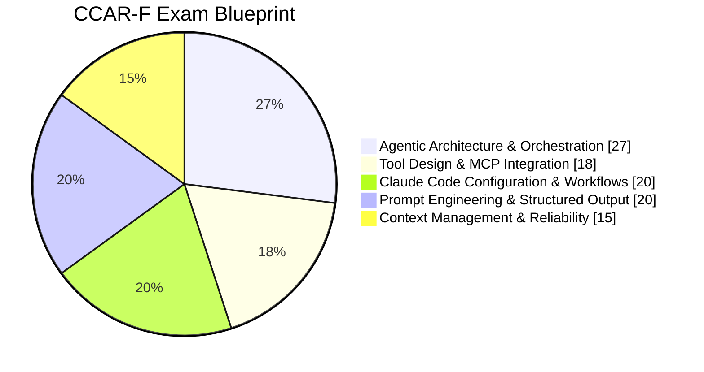
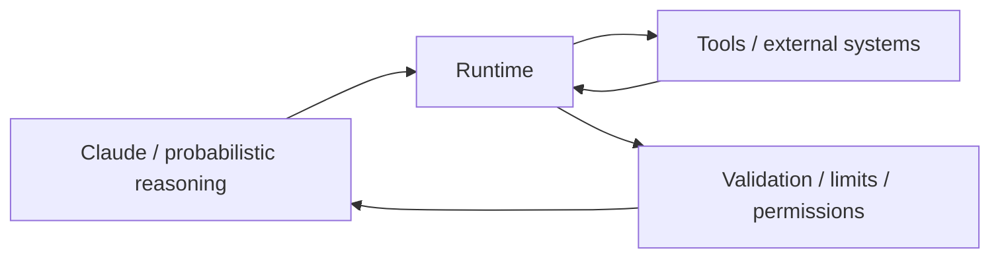

# 01 — CCAR-F Exam Overview

> **Última revisión de esta guía:** octubre de 2026  
> **Exam Guide:** Version 1.0 · Effective July 2026  
> **Exam code:** `CCAR-F`

---

# 1. Qué certifica CCAR-F

**Claude Certified Architect – Foundations** evalúa si una persona puede tomar decisiones técnicas razonables al diseñar e implementar soluciones de producción con Claude.

El foco no es recordar definiciones aisladas.

El foco es reconocer **trade-offs** dentro de escenarios realistas.

Tecnologías centrales del scope:

- Claude API
- Claude Agent SDK
- Claude Code
- Model Context Protocol (`MCP`)

---

# 2. Exam at a glance

| Dato | Valor |
|---|---|
| Exam code | `CCAR-F` |
| Items | **60** |
| Tiempo | **120 minutos** |
| Formato | **multiple-choice** y **multiple-response** |
| Estructura | **4 scenarios** seleccionados de un banco de **6** |
| Idioma | **English** |
| Passing score | **720** |
| Escala | **100–1000** |
| Precio de lista | **USD 125 por intento** |
| Entrega | proctored online / Pearson VUE test center |
| Validez de la credencial | **12 meses** |

## 🔴 EXAM CRITICAL — `720` no significa `72%`

El resultado utiliza **scaled scoring**.

Por lo tanto:

```text
720 / 1000
≠
72% correct
```

No existe una conversión segura entre porcentaje de preguntas correctas y scaled score.

---

# 3. Tiempo

```text
120 minutes / 60 items
≈ 2 minutes per item
```

No significa que debas gastar exactamente dos minutos en cada pregunta.

Estrategia:

1. resolver rápido lo evidente;
2. marcar dudas;
3. volver al final;
4. no gastar demasiado tiempo en una única ambigüedad.

---

# 4. Los cinco dominios



| Domain | Weight |
|---|---:|
| 1. Agentic Architecture & Orchestration | **27%** |
| 2. Tool Design & MCP Integration | **18%** |
| 3. Claude Code Configuration & Workflows | **20%** |
| 4. Prompt Engineering & Structured Output | **20%** |
| 5. Context Management & Reliability | **15%** |

Total: **30 task statements**.

---

# 5. Los seis escenarios publicados

El Exam Guide utiliza escenarios de producción para contextualizar las preguntas.

El banco publicado incluye:

1. **Customer Support Resolution Agent**
2. **Code Generation with Claude Code**
3. **Multi-Agent Research System**
4. **Developer Productivity with Claude**
5. **Claude Code for Continuous Integration**
6. **Structured Data Extraction**

Cada exam form utiliza cuatro de ellos.

### Qué significa esto para estudiar

No alcanza con saber:

> “qué es MCP”

Hay que poder razonar:

> “en este customer-support agent, ¿qué diseño de MCP/tool reduce ambigüedad, limita authority y permite recoverability?”

---

# 6. Cómo pensar una pregunta del examen

Una pregunta suele presentar varias opciones técnicamente posibles.

El objetivo es elegir la que mejor satisface las restricciones.

Pensá en:

```text
Requirement
    ↓
Constraint
    ↓
Failure mode
    ↓
Smallest reliable design
    ↓
Correct trade-off
```

Ejemplo:

> Necesitamos garantizar que un agent no exceda 10 iterations.

Opciones hipotéticas:

A. indicarlo en el system prompt  
B. pedir al model que lleve un contador  
C. imponer el límite programáticamente en el orchestrator  
D. bajar temperature

La mejor respuesta es **C** porque el requirement es una invariant que necesita deterministic enforcement.

---

# 7. Mental model para CCAR-F

Una regla aparece repetidamente en arquitectura:

> **Probabilistic intelligence + deterministic control.**

El model es útil para:

- reasoning;
- classification;
- planning;
- synthesis;
- dynamic decisions.

El código/runtime es mejor para:

- hard limits;
- permissions;
- validation;
- deterministic checks;
- retries;
- auditability.



---

# 8. Estrategia de estudio de esta guía

No estudiar por cantidad de videos.

Estudiar hasta poder:

1. explicar el concepto;
2. reconocer cuándo usarlo;
3. reconocer cuándo **no** usarlo;
4. identificar su failure mode;
5. elegir el trade-off correcto;
6. aplicar el concepto en un escenario.

---

# 9. Preguntas de repaso

### Pregunta 1

¿Un passing score de `720/1000` significa que necesitás exactamente 72% de respuestas correctas?

<details>
<summary>Ver respuesta</summary>

No.

Es un **scaled score**. No debe transformarse directamente en porcentaje de respuestas correctas.

</details>

### Pregunta 2

¿Cuántos domains tiene el blueprint?

<details>
<summary>Ver respuesta</summary>

Cinco.

</details>

### Pregunta 3

¿Cuál es el domain con mayor peso?

<details>
<summary>Ver respuesta</summary>

**Agentic Architecture & Orchestration — 27%**.

</details>

### Pregunta 4

¿Por qué estudiar sólo definiciones es insuficiente?

<details>
<summary>Ver respuesta</summary>

Porque el examen se estructura alrededor de production scenarios y evalúa **architectural judgment y trade-offs**, no únicamente recall.

</details>

---

# 10. Summary end-to-end

```text
CCAR-F
  ↓
60 scenario-based items
  ↓
4 production scenarios
  ↓
5 weighted domains
  ↓
30 task statements
  ↓
architectural decisions
  ↓
trade-offs + reliability + implementation judgment
```

La preparación correcta consiste en construir un mental model suficientemente fuerte para decidir entre varias soluciones plausibles.

---

# 11. Fuentes

## Canonical / oficiales

- Anthropic Academy — Claude Certified Architect – Foundations  
  https://anthropic-partners.skilljar.com/claude-certified-architect-foundations-certification
- Anthropic Certification FAQ  
  https://anthropic-partners.skilljar.com/page/faq-certifications
- Anthropic Partner Network announcement  
  https://www.anthropic.com/news/claude-partner-network

## Exam Guide

La guía sigue **Claude Certified Architect – Foundations Exam Guide, Version 1.0, Effective July 2026**.

> Antes de registrar el examen se deben verificar nuevamente precio, políticas y modalidad en la página oficial, porque son datos operativos susceptibles a cambios.
