# Capítulo 2 — De un LLM a un Agent

[← Capítulo 1](../01-exam-overview/README.md) · [Roadmap](../ROADMAP.md) · [Laboratorio BitSupport](../lab-bit-support/README.md)

> **Domain principal:** Agentic Architecture & Orchestration  
> **Curso backbone:** Jacob Bushong — `D1: Agentic Architecture - Foundations`  
> **Validación y complemento:** documentación oficial de Anthropic.

---

En el capítulo 0 presentamos BitSupport como un asistente interno para un equipo de ingeniería.

Hasta ahora puede conversar.

Un developer le pregunta:

> “¿Qué significa un HTTP 502?”

y Claude puede explicarlo.

Ahora llega una pregunta distinta:

> “¿Falló el último deploy de payments-api en QA?”

Ésta parece una diferencia pequeña, pero cambia la arquitectura completa.

Para responder de manera confiable, BitSupport ya no puede limitarse a generar texto. Necesita **observar algo que existe fuera del model**.

Este capítulo trata justamente de ese salto:

> cómo pasamos de un LLM que responde a un sistema que puede **decidir, actuar, observar y volver a decidir**.

Al final vamos a entender por qué eso no significa que debamos convertir todo en un autonomous agent.

---

# 1. El primer límite: Claude no vive dentro de tus sistemas

Un LLM puede razonar sobre la idea de un deployment.

Puede decirte:

- qué suele causar un fallo;
- cómo leer un log;
- qué significa un error;
- qué revisar primero.

Pero no conoce automáticamente:

- el estado actual de Jenkins;
- el contenido de tu database;
- el último commit de un private repository;
- si un servicio está healthy;
- si un ticket cambió hace cinco minutos.

Ésa es la primera frontera que necesitamos visualizar.

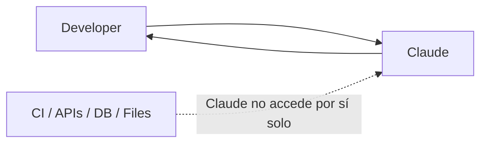

Jacob llama a esta separación el **action–environment gap**.

La idea es sencilla:

> el model puede generar una intención o una decisión, pero hace falta otra capa que conecte esa decisión con el mundo externo.

---

# 2. Le damos una capacidad a BitSupport

Supongamos que escribimos una función Python:

```python
def get_deployment_status(service: str, environment: str) -> dict:
    ...
```

La función sabe consultar nuestro sistema de deployments.

Pero todavía tenemos una pregunta:

> ¿cómo sabe Claude que esa función existe y cuándo debería usarla?

Ahí aparece el concepto de **tool**.

Una tool es una capability que ponemos a disposición del model mediante una definición estructurada.

Por ejemplo:

```json
{
  "name": "get_deployment_status",
  "description": "Returns the latest deployment status for a service and environment.",
  "input_schema": {
    "type": "object",
    "properties": {
      "service": {
        "type": "string"
      },
      "environment": {
        "type": "string",
        "enum": ["dev", "qa", "prod"]
      }
    },
    "required": ["service", "environment"]
  }
}
```

Hay tres piezas que conviene separar mentalmente:

### `name`
Identifica la capability.

### `description`
Ayuda al model a entender **qué hace y cuándo corresponde usarla**.

### `input_schema`
Define qué argumentos son válidos.

Este detalle parece pequeño ahora. Más adelante, en Tool Design, vamos a dedicarle un capítulo entero.

---

## 🔴 EXAM CRITICAL — Tool design no es documentación decorativa

Claude no inspecciona el código interno de `get_deployment_status()` para decidir si corresponde llamarlo.

El model ve la interfaz que le damos.

Por eso una tool mal descripta puede provocar:

- selección incorrecta;
- parámetros ambiguos;
- omisión de una tool necesaria;
- resultados difíciles de utilizar.

Una forma útil de recordarlo es:

```text
description
→ ayuda a decidir cuándo usarla

schema
→ limita cómo invocarla

tool result
→ determina qué información tendrá el próximo turn
```

---

# 3. La primera llamada: `tool_use`

Volvamos a la pregunta:

> “¿Falló el último deploy de payments-api en QA?”

Claude recibe:

- el mensaje;
- las instructions;
- la definición de `get_deployment_status`.

Si decide que necesita esa capability, no ejecuta directamente nuestro Python.

Produce un bloque estructurado de tipo **`tool_use`**.

Conceptualmente:

```json
{
  "type": "tool_use",
  "name": "get_deployment_status",
  "input": {
    "service": "payments-api",
    "environment": "qa"
  }
}
```

Para client-executed tools, el response termina normalmente con:

```text
stop_reason = "tool_use"
```

Eso significa, en términos prácticos:

> “Necesito que la aplicación ejecute esta acción antes de poder continuar.”

---

# 4. El runtime toma el control

Ahora entra en escena el **runtime** que presentamos en el capítulo 0.

Nuestro código:

1. recibe el `tool_use`;
2. identifica la tool;
3. valida/lee los arguments;
4. ejecuta la función real;
5. obtiene el resultado.

Supongamos que devuelve:

```json
{
  "service": "payments-api",
  "environment": "qa",
  "status": "failed",
  "reason": "health check timeout"
}
```

La aplicación transforma eso en un **`tool_result`** y lo envía de vuelta a Claude.

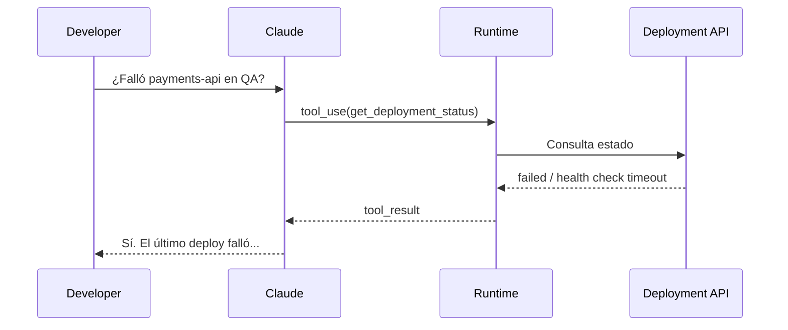

Ahora Claude tiene una observation que no existía cuando empezó el turn.

Y ahí aparece una idea mucho más poderosa que una simple function call.

---

# 5. El feedback loop

Supongamos que BitSupport recibe este resultado:

```text
status = failed
reason = health check timeout
```

¿Qué debería hacer?

Tal vez la respuesta ya sea suficiente.

Pero quizás el usuario había pedido:

> “Investigá por qué falló.”

Entonces Claude puede decidir:

1. consultar el deployment;
2. observar que falló por health check;
3. consultar logs;
4. observar un connection timeout;
5. consultar service ownership;
6. sintetizar la causa probable.

El plan fue cambiando en función de lo que iba encontrando.

Eso es el corazón del **agentic loop**.

---

# 6. Perceive → Reason → Act → Observe

Podemos representar el loop de varias maneras.

En el curso se presenta con cuatro fases:

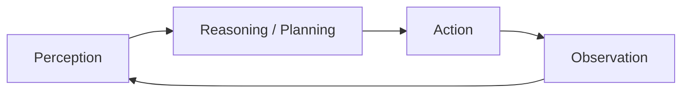

No hace falta memorizar los nombres como si fueran una fórmula.

Lo importante es entender qué representa cada fase.

---

## Perception — ¿qué sé ahora?

Claude lee el context disponible:

- original instructions;
- user request;
- conversation history;
- documents;
- previous actions;
- tool results.

En nuestro ejemplo:

> “El deploy falló y la causa reportada es health check timeout.”

Ese dato no existía antes de ejecutar la tool.

---

## Reasoning / Planning — ¿qué conviene hacer ahora?

Claude compara:

```text
current state
vs
goal
```

El goal era investigar la falla.

Con la nueva observation puede decidir:

> “Necesito revisar logs.”

Lo importante es que **esa decisión no tenía por qué existir antes de recibir el resultado anterior**.

---

## Action — salir del model

El model genera una acción.

Por ejemplo:

```text
get_service_logs(
    service="payments-api",
    environment="qa"
)
```

El runtime la ejecuta.

---

## Observation — traer el mundo de vuelta

La tool devuelve algo nuevo:

```text
database connection timed out after 30s
```

Esa información vuelve al context.

El loop puede empezar otra vez.

---

# 7. ¿Esto ya es un Agent?

Acá aparece una de las distinciones más importantes de todo CCAR-F.

Usar tools **no convierte automáticamente** un sistema en agent.

Imaginemos dos versiones de BitSupport.

---

## Versión A — Workflow

El developer programa esto:

```text
1. get deployment
2. get logs
3. summarize
```

Siempre ocurre en ese orden.

Aunque Claude participe en los tres pasos, el control flow ya estaba escrito.

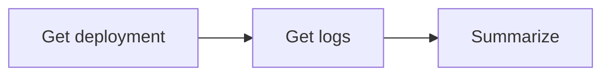

Eso es un **workflow**.

---

## Versión B — Agentic

Ahora le damos a Claude varias tools:

- `get_deployment_status`;
- `get_service_logs`;
- `search_internal_docs`;
- `get_service_owner`.

Claude observa el resultado de cada paso y decide qué necesita después.

Una ejecución podría ser:

```text
deployment
→ logs
→ docs
→ answer
```

Otra:

```text
deployment
→ service owner
→ logs
→ escalate
```

El sequence emerge **at runtime**.

Ahí sí tenemos comportamiento agentic.

---

## 🔴 EXAM CRITICAL — la pregunta que separa Workflow de Agent

No preguntes:

> “¿usa un LLM?”

Preguntá:

> **¿quién decide el control flow?**

### Workflow
El developer define el path **at design time**.

### Agent
El model dirige dinámicamente el proceso **at runtime**.

Ésta es una de las ideas que más conviene internalizar en lugar de memorizar.

---

## 💭 Pensalo antes de seguir

Un pipeline hace:

```text
Claude classify
→ Claude extract
→ Claude summarize
```

¿Es un agent porque hay tres llamadas a Claude?

<details>
<summary>Ver respuesta</summary>

No.

Si el developer decidió de antemano que ésos son siempre los tres pasos y ese orden no cambia, sigue siendo un **workflow**.

La cantidad de LLM calls no determina agency.

</details>

---

# 8. Entonces, ¿qué es un augmented LLM?

Anthropic utiliza **augmented LLM** para describir el building block que surge cuando un model se combina con capacidades adicionales como:

- retrieval;
- tools;
- memory.

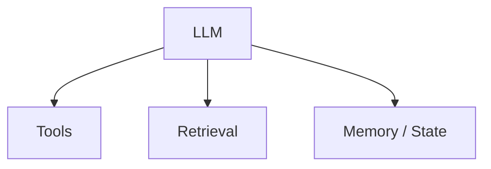

Esto es importante porque nos permite pensar la arquitectura por capas.

No saltamos directamente de:

```text
LLM
→ autonomous multi-agent system
```

Primero construimos un model enriquecido con capabilities.

Después decidimos cómo orquestarlas.

---

# 9. Agency es un spectrum, no un interruptor

En sistemas reales hay muchos puntos intermedios.

```text
deterministic workflow
        ↓
workflow with LLM steps
        ↓
routing / parallel workflows
        ↓
workflow with bounded agentic component
        ↓
agent
        ↓
high-autonomy agent
```

La pregunta correcta no es:

> “¿Cómo hago que mi sistema sea lo más agentic posible?”

Es:

> **¿Cuánta autonomy necesita realmente este problema?**

Esto conecta directamente con una recomendación oficial de Anthropic: empezar por la solución más simple y agregar complejidad sólo cuando haga falta.

---

# 10. Antes de elegir un Agent, conozcamos los Workflows

Una de las razones por las que se sobreutilizan agents es que se subestima todo lo que puede hacerse con workflows.

Anthropic describe cinco patrones especialmente útiles.

Los vamos a mirar dentro de BitSupport.

---

## 10.1 Prompt Chaining

Supongamos que siempre queremos:

1. resumir un incident;
2. extraer acciones;
3. generar un reporte.


El sequence es fijo.

No necesitamos runtime planning.

---

## 10.2 Routing

BitSupport recibe requests de diferentes tipos:

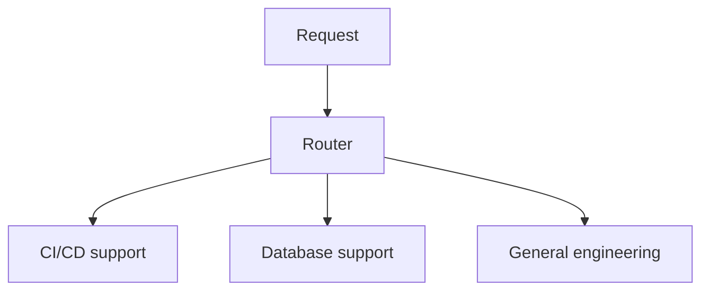

El router podría incluso ser un LLM.

Pero las rutas posibles y la topology están predefinidas.

Sigue siendo un workflow.

---

## 10.3 Parallelization

Tenemos que revisar tres fuentes independientes:

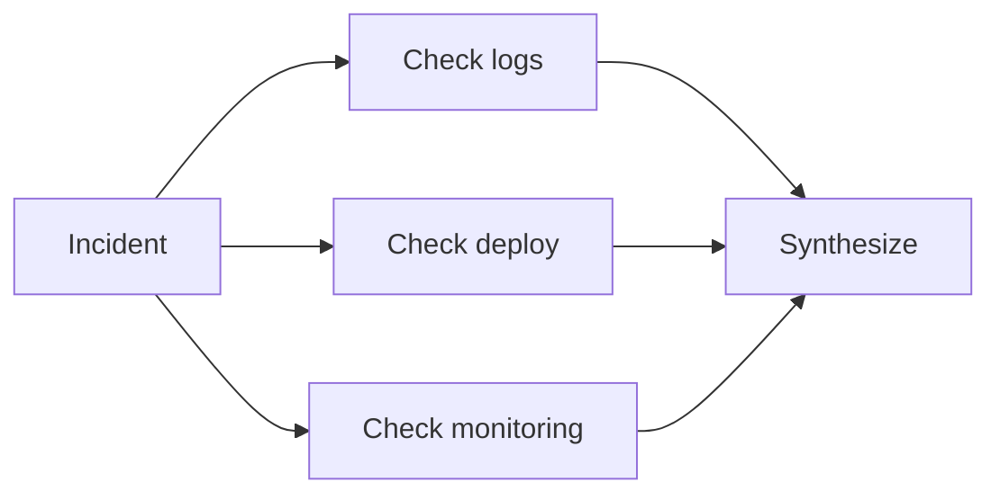

Ejecutarlas en paralelo reduce latency.

No hace falta autonomía para eso.

---

## 10.4 Orchestrator–Workers

Un componente toma una tarea y la distribuye entre workers especializados.

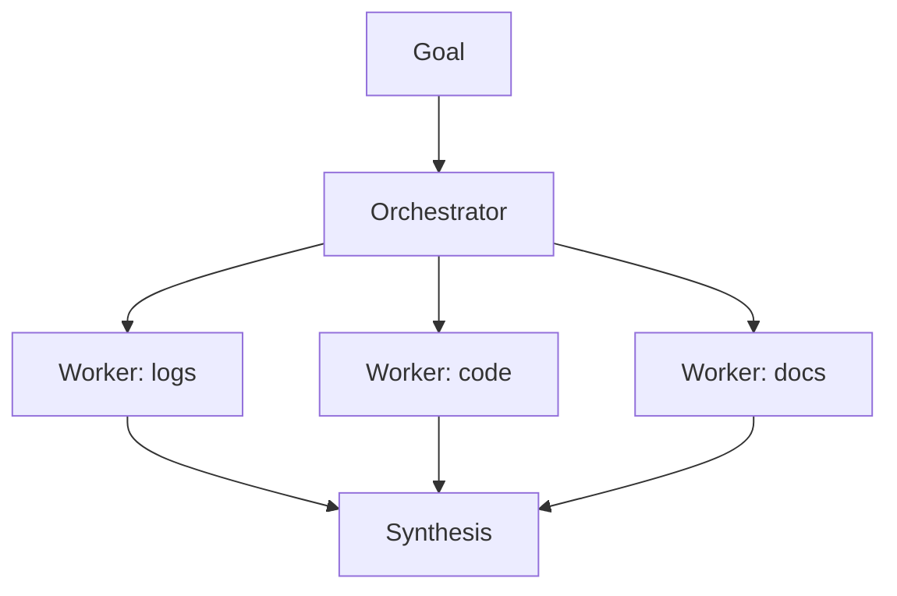

Acá aparece una nuance importante.

Un LLM puede participar en la decomposition, pero Anthropic aun así presenta **orchestrator–workers** como un workflow pattern cuando la arquitectura general está bounded.

Por eso no conviene clasificar sistemas sólo mirando una decision aislada.

---

## 10.5 Evaluator–Optimizer

BitSupport genera una respuesta técnica.

Otro paso la evalúa contra criterios claros.

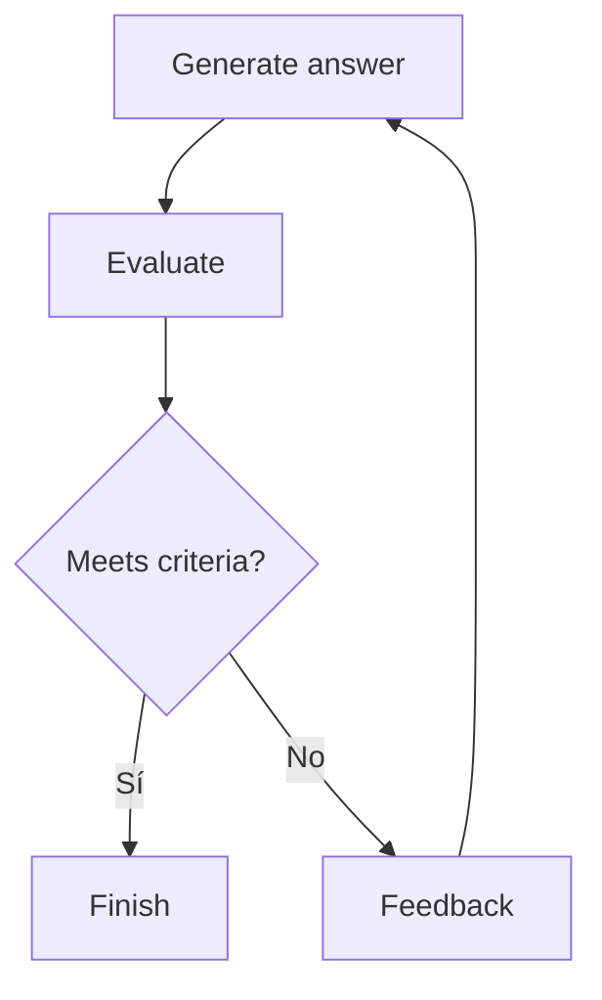

Tenemos un loop, pero el control flow sigue siendo diseñado por nosotros.

---

# 11. ¿Cuándo un Workflow es mejor?

Volvamos a una regla muy simple:

> si podés escribir razonablemente todos los pasos antes de ejecutar, probablemente no necesitás un agent.

Un workflow suele ganar cuando:

- input format is predictable;
- output format is known;
- processing steps are known;
- failures tienen fallbacks conocidos;
- auditability es muy importante;
- cost y latency necesitan ser predecibles.

Por ejemplo:

```text
invoice
→ extract fields
→ validate schema
→ apply business rules
→ save
```

Agregar un autonomous agent acá puede ser sofisticación sin beneficio.

---

# 12. ¿Cuándo empieza a justificarse un Agent?

Ahora cambiemos el request de BitSupport:

> “Investigá por qué payments-api está degradando en producción. Podés usar logs, deployments, documentación y ownership. Si no podés resolverlo con confianza, indicá a qué equipo escalarlo.”

No sabemos de antemano:

- qué tool será necesaria primero;
- si habrá que consultar todas;
- cuántas iterations harán falta;
- si una observation cambiará por completo el plan.

Ahí aparecen tres señales fuertes:

### 1. Open-ended goal
Conocemos el objetivo, pero no todos los pasos.

### 2. Unpredictable tool sequence
No sabemos qué tools ni en qué orden serán necesarias.

### 3. Dynamic replanning
Los intermediate results cambian el siguiente paso.

Éste es el terreno natural para un bounded agent.

---

# 13. Pero ahora aparece otro problema: ¿cómo hacemos que se detenga?

Le dimos a BitSupport freedom para:

- elegir tools;
- repetir pasos;
- cambiar el plan.

Eso agrega capability.

También agrega riesgo.

¿Qué pasa si hace esto?

```text
search logs
→ same error
→ search logs
→ same error
→ search logs
→ same error
→ ...
```

Un agent que nunca termina no es “más autónomo”.

Es un production bug caro.

---

# 14. Loop control

Todo agent serio necesita criterios externos de control.

Tres conceptos básicos:

### Termination condition
Condición que indica que el trabajo terminó.

### Turn / iteration budget
Hard limit sobre cuánto puede continuar.

### Escalation
Salida controlada hacia una persona u otro sistema cuando el agent no debería seguir solo.

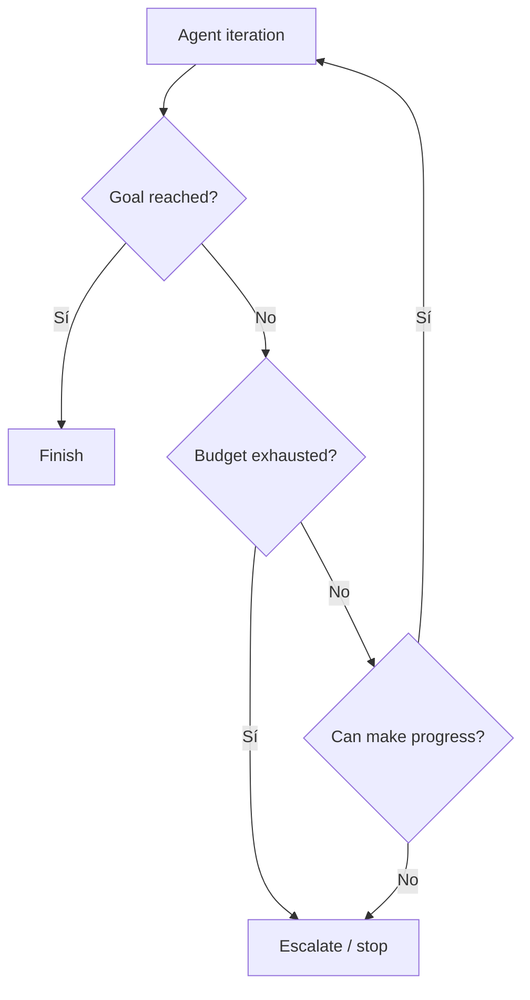

---

## 🔴 EXAM CRITICAL — hard guarantees pertenecen al runtime

No dependas únicamente de un prompt como:

```text
"Never run more than 10 iterations."
```

El model puede seguir instructions, pero si el requirement es:

> “el system **nunca** debe superar diez turns”

entonces el runtime debe imponerlo programáticamente.

```python
MAX_TURNS = 10

for turn in range(MAX_TURNS):
    ...
```

Recordá:

```text
prompt
= behavioral guidance

programmatic guard
= enforcement
```

---

# 15. `stop_reason` no es lo mismo que termination condition

Esta diferencia es sutil y examinable.

La API devuelve un **`stop_reason`** para explicar por qué terminó una model response.

Por ejemplo:

- `tool_use`;
- `end_turn`;
- `max_tokens`;
- otros según el tipo de ejecución.

Eso no reemplaza la lógica del system.

### `stop_reason`
Describe el turn del model.

### termination condition
Describe la policy de tu application.

Por ejemplo:

```text
stop_reason = end_turn
```

no significa automáticamente:

> “el incident quedó resuelto correctamente”.

Tu application todavía puede necesitar validar business criteria.

---

# 16. Progress vs Spinning

Hay otra distinción muy útil.

Un agent puede estar haciendo muchas cosas y aun así no estar avanzando.

## Progress

Cada iteration aporta una observation nueva que reduce la distancia al goal.

```text
deployment failed
→ inspect logs
→ DB timeout found
→ inspect runbook
→ identify remediation
```

## Spinning

La actividad se repite sin meaningful state change.

```text
same search
→ same result
→ same search
→ same result
```

Podemos detectar spinning observando:

- same tool + same parameters;
- repeated error;
- nearly identical observations;
- many turns without narrowing the problem.

---

# 17. Retry o Escalation

Cuando una acción falla, no existe una única respuesta correcta.

## Retry tiene sentido cuando

- el failure es recoverable;
- hay parámetros alternativos;
- apareció new information;
- existe another strategy.

Ejemplo:

> una búsqueda fue demasiado amplia → refinar query.

## Escalation tiene sentido cuando

- falta authorization;
- falta información que debe aportar una persona;
- la próxima acción tiene high consequence;
- el agent ya agotó retries;
- no hay progreso;
- se necesita human judgment.

---

## 💭 Pensalo antes de seguir

BitSupport intenta actualizar automáticamente una configuración de producción, pero la tool devuelve:

```text
permission denied: production changes require human approval
```

¿Qué conviene?

A. repetir la misma llamada cinco veces;  
B. modificar parámetros para intentar saltar el control;  
C. escalar a la persona/flujo autorizado;  
D. ignorar el error y decir que el cambio se realizó.

<details>
<summary>Ver respuesta</summary>

**C**.

El problema no es transitorio. Es un **authorization boundary**.

Retry no agrega nueva información ni cambia la autoridad del agent.

Escalation es el comportamiento confiable.

</details>

---

# 18. La arquitectura más útil suele ser Hybrid

No tenemos que elegir siempre entre:

```text
100% workflow
vs
100% agent
```

Imaginemos que BitSupport recibe cien consultas.

Noventa son conocidas:

- consultar deploy;
- consultar ownership;
- buscar una página de documentación.

Diez requieren investigación.

Una arquitectura razonable puede ser:

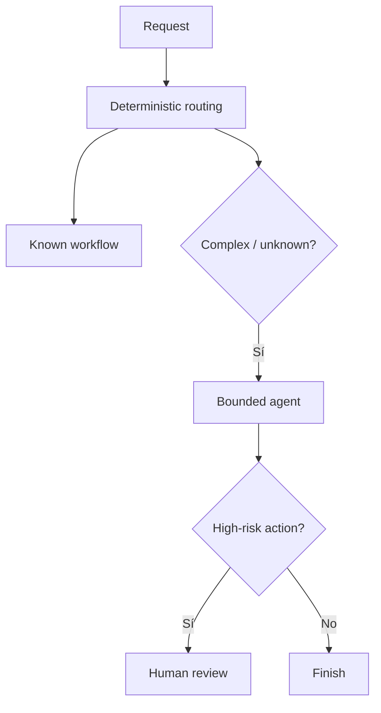

Así obtenemos predictability donde podemos y autonomy donde realmente aporta valor.

---

# 19. Tres trade-offs para decidir

Cuando dudes entre workflow y agent, pensá en estos ejes.

## Cost vs Capability

Un agent suele necesitar:

- more turns;
- more tokens;
- more tool calls.

¿La additional capability lo justifica?

## Auditability vs Flexibility

Workflow:

- path más claro;
- easier logs;
- reproducibility más alta.

Agent:

- path variable;
- más capacidad de adaptación.

¿Qué necesita el use case?

## Reliability vs Adaptability

Workflow:

- failures más localizados;
- behavior más predecible.

Agent:

- puede recover/replan;
- introduce más possible paths.

---

# 20. Una corrección importante del material base

En la lecture `Choosing the Right Architecture` aparecen cuatro preguntas diagnósticas.

El problema es que un “yes” no apunta siempre a la misma opción:

| Pregunta | Señal Workflow | Señal Agent |
|---|---|---|
| ¿Los steps pueden definirse beforehand? | **Sí** | No |
| ¿El output es known/testable? | **Sí** | No / open-ended |
| ¿Necesitamos dynamic tool selection? | No | **Sí** |
| ¿Necesitamos dynamic replanning? | No | **Sí** |

Por eso no vamos a memorizar una cuenta de “yes/no”.

Vamos a usar la idea más robusta:

```text
mostly predictable
→ workflow

path emerges from runtime evidence
→ bounded agent

mixed
→ hybrid
```

---

# 21. 🧪 Probalo vos — primera evolución de BitSupport

Ya tenemos suficiente teoría para llevar el loop a código.

El primer lab implementa:

```text
user request
→ Claude
→ tool_use
→ Python executes tool
→ tool_result
→ Claude
→ final response
```

Y además agrega un hard `MAX_TURNS` para que el runtime mantenga el control.

### 👉 [Ir al Lab 1 — Del chatbot al agentic loop](../lab-bit-support/01-agentic-loop/README.md)

No lo leas solamente.

Ejecutalo, modificá la tool y forzá algún error.

La intención es que veas físicamente qué parte pertenece al model y qué parte pertenece a tu código.

---

# 22. 🧩 Challenge de arquitectura

Tenemos tres requirements distintos.

Clasificá cada uno como **Workflow**, **Agent** o **Hybrid**.

### Caso A

Recibimos una factura con formato conocido.

Siempre necesitamos:

```text
extract
→ validate
→ persist
```

<details>
<summary>Ver respuesta</summary>

**Workflow**.

El path está totalmente definido y el output es testable.

Un agent agregaría freedom sin aportar una capability necesaria.

</details>

### Caso B

El usuario pide investigar un incidente sin causa conocida.

El sistema puede consultar logs, deployments, documentation y service metadata. Cada observation determina qué conviene revisar después.

<details>
<summary>Ver respuesta</summary>

**Agent**, preferentemente bounded.

El tool sequence no puede definirse completamente beforehand y necesitamos dynamic replanning.

</details>

### Caso C

Las consultas comunes tienen pasos conocidos, pero los casos ambiguos requieren investigación abierta.

<details>
<summary>Ver respuesta</summary>

**Hybrid**.

Mantenemos un workflow para el common path y concedemos autonomy sólo a los casos donde tiene valor.

</details>

---

# 23. Exam-style question

Un engineering assistant dispone de 15 tools. Para una tarea específica, siempre debe consultar dos servicios en un orden fijo y luego generar un summary. El equipo propone permitir que Claude decida libremente qué tools llamar porque “agents are more capable”.

¿Cuál es la mejor decisión?

A. Usar agentic tool selection para maximizar flexibility.  
B. Mantener un deterministic workflow para esos pasos.  
C. Aumentar el context window.  
D. Crear varios subagents para cada service.

<details>
<summary>Ver respuesta y análisis</summary>

**Respuesta correcta: B.**

### B — correcta
El path ya es conocido. Un deterministic workflow es más simple, testable y auditable.

### A — incorrecta
Agrega autonomy donde no existe una necesidad de runtime judgment.

### C — incorrecta
Context size no resuelve una decisión de control flow.

### D — incorrecta
Multi-agent orchestration agregaría todavía más complexity sin necesidad.

### Señal del scenario
La frase clave es:

> “siempre debe consultar dos servicios en un orden fijo”.

Eso prácticamente define un workflow.

</details>

---

# 24. Summary — la historia completa del capítulo

Empezamos con BitSupport siendo apenas un chatbot.

Podía responder preguntas generales, pero fallaba en cuanto le pedíamos información actual de nuestros sistemas.

Ahí apareció el **action–environment gap**.

Para cruzarlo le dimos una **tool**.

Claude pudo expresar una decisión mediante `tool_use`, pero la decisión todavía no ejecutaba nada. Necesitamos un **runtime** que tomara esa solicitud, ejecutara código real y devolviera un `tool_result`.

En ese momento apareció algo nuevo: **feedback**.

Claude podía observar el resultado de una acción y decidir qué hacer después.

Ese ciclo:

```text
perceive
→ reason
→ act
→ observe
→ repeat
```

es el **agentic loop**.

Pero después descubrimos una distinción todavía más importante.

No todo sistema con tools es un agent.

Si nosotros definimos el sequence beforehand, tenemos un **workflow**.

Si el model elige dinámicamente los próximos pasos basándose en observations, tenemos comportamiento **agentic**.

Y eso nos obligó a hablar de control.

Un agent necesita:

- termination conditions;
- hard budgets;
- retry rules;
- escalation;
- observability.

Porque autonomy sin boundaries aumenta capability, pero también aumenta risk.

Finalmente llegamos a la decisión arquitectónica más importante del capítulo:

> **empezar por la solución más simple y hacer que la complexity se gane su lugar.**

Workflow cuando el path es conocido.

Agent cuando el path tiene que emerger de runtime evidence.

Hybrid cuando sólo una parte del problema necesita autonomy.

Ésta no es sólo una regla para aprobar CCAR-F.

Es una regla sana para construir software con LLMs.

---

# 25. Qué deberías poder explicar sin mirar

Antes de avanzar, intentá explicar con tus propias palabras:

- por qué un LLM solo no es un agent;
- qué hace una tool;
- qué hace el runtime;
- qué diferencia `tool_use` de `tool_result`;
- cómo funciona el agentic loop;
- workflow vs agent;
- qué es spinning;
- retry vs escalation;
- por qué los hard limits deben estar en código;
- cuándo elegir una hybrid architecture.

Si alguna explicación todavía suena memorizada, volvé al ejemplo de BitSupport.

---

# Fuentes y trazabilidad

## Material base

Jacob Bushong — *Claude Certified Architect (CCAR-F) - 2026 Exam Prep*  
Section: **D1: Agentic Architecture - Foundations**

Lectures procesadas:

- Agents, Workflows, and Chatbots — What's Actually Different
- Tool Use as the Foundation of Agency
- Perception, Reasoning, Action, and Observation
- Loop Control — Stopping, Iterating, and Escalating
- When Workflows Outperform Agents
- Choosing the Right Architecture

La lecture de feedback no agrega contenido técnico y no se incorpora como tema.

## Validación / complemento oficial

- Anthropic — Building Effective Agents  
  https://www.anthropic.com/engineering/building-effective-agents
- Claude Platform Docs — How tool use works  
  https://platform.claude.com/docs/en/agents-and-tools/tool-use/how-tool-use-works
- Claude Platform Docs — Handle tool calls  
  https://platform.claude.com/docs/en/agents-and-tools/tool-use/handle-tool-calls
- Claude Platform Docs — Stop reasons and fallback  
  https://platform.claude.com/docs/en/build-with-claude/handling-stop-reasons
- Anthropic — Writing effective tools for agents  
  https://www.anthropic.com/engineering/writing-tools-for-agents

---

# ¿Qué sigue?

Hasta ahora le dimos a BitSupport freedom para elegir una próxima acción.

Pero todavía asumimos que el goal era relativamente simple.

¿Qué pasa cuando el request es:

> “Investigá este incidente, determiná posibles causas, verificá cada hipótesis y proponé una solución.”

Antes de ejecutar tools necesitamos aprender a **descomponer el problema y planificar**.

Ése es el próximo paso.

### Siguiente capítulo: **Task Decomposition & Planning**

Se habilitará cuando procesemos la próxima sección del curso.
