# 02 — Agentic Architecture: Foundations

> **Curso backbone:** Jacob Bushong — Section `D1: Agentic Architecture - Foundations`  
> **Material base:** transcripción de las lectures técnicas de la sección.  
> **Validación/complemento:** documentación oficial de Anthropic.

---

# 1. Objetivo

Al terminar esta sección deberías poder responder:

- ¿qué diferencia un `workflow` de un `agent`?
- ¿qué hace que un sistema sea realmente `agentic`?
- ¿cómo funciona un `agentic loop`?
- ¿qué papel cumplen `tool_use` y `tool_result`?
- ¿cuándo conviene iteration, retry o escalation?
- ¿por qué no siempre conviene construir un agent?
- ¿cómo elegir entre workflow, agent e hybrid architecture?

---

# 2. La idea más importante

La diferencia central no es:

```text
"¿usa un LLM?"
```

La pregunta correcta es:

> **¿Quién decide el próximo paso y cuándo?**

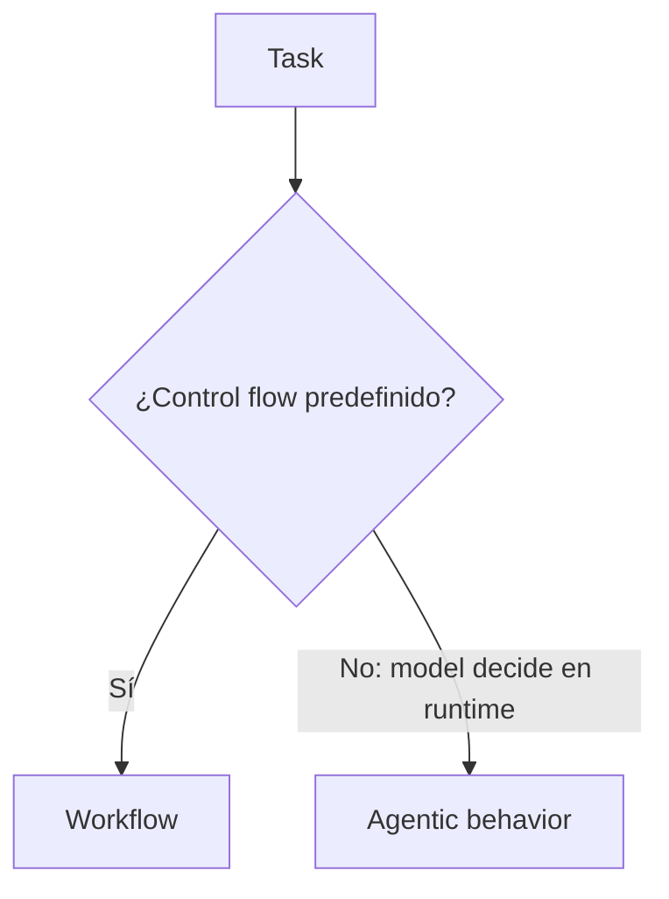

---

# 3. Chatbot, Workflow y Agent

## Chatbot

Modelo simple:

```text
User message
    ↓
Model
    ↓
Response
```

Un model call por sí solo no ejecuta APIs, modifica databases ni obtiene durable memory.

> La **application** sí puede guardar history/state. Por eso es más preciso decir que el modelo no obtiene persistence o side effects automáticamente.

## Workflow

El developer define el control flow **at design time**.

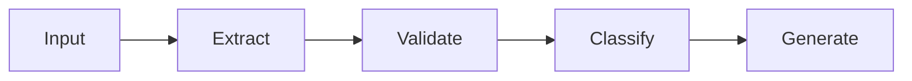

Aunque varios pasos usen un LLM, sigue siendo workflow si la secuencia fue predeterminada.

### Ventajas

- predictability;
- testability;
- auditability;
- lower cost;
- lower latency;
- localized failures.

## Agent

El model decide dinámicamente qué hacer según el estado actual.

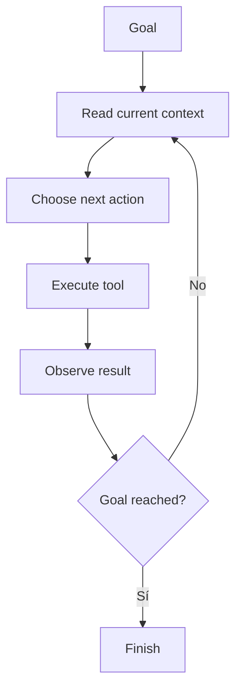

### Ventajas

- adaptability;
- dynamic planning;
- open-ended problem solving.

### Costos

- variable cost;
- more latency;
- broader failure surface;
- harder debugging;
- harder auditing.

---

# 4. Autonomy is a spectrum

No existe sólo:

```text
workflow OR fully autonomous agent
```

La mayoría de sistemas útiles combina niveles de autonomy.

```text
deterministic workflow
        ↓
workflow + LLM classification
        ↓
workflow + bounded agentic step
        ↓
bounded agent
        ↓
high-autonomy agent
```

🔴 **EXAM CRITICAL**

> No maximices autonomy. Concedé sólo la autonomy que el task realmente necesita.

---

# 5. Action–Environment Gap

Un LLM produce model output.

Decir:

> “voy a consultar el inventario”

no consulta el inventario.

Hace falta un runtime:

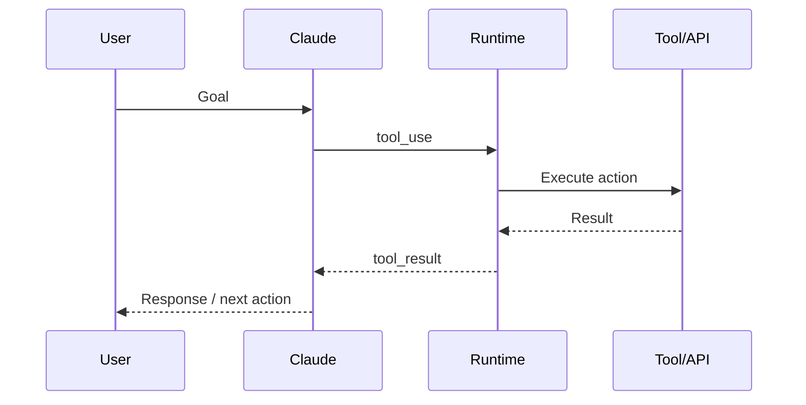

Éste es el puente entre reasoning y real-world action.

---

# 6. Augmented LLM

Un **augmented LLM** combina el model con capacidades adicionales.

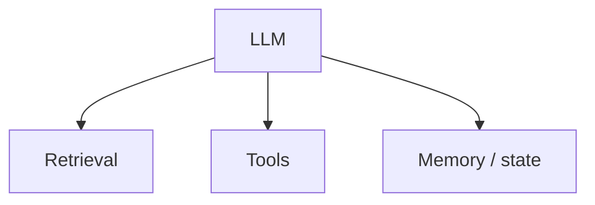

Éste es un building block de sistemas agentic.

---

# 7. Agentic Loop

Jacob lo presenta como:

```text
Perception
→ Reasoning
→ Action
→ Observation
→ repeat
```

## Perception

El model lee lo disponible:

- instructions;
- conversation;
- documents;
- previous tool calls;
- tool results;
- current state.

Pregunta mental:

> **¿Qué sé ahora?**

## Reasoning / Planning

Compara:

```text
current state
vs
goal state
```

y elige la next action.

## Action

Puede producir:

- final response;
- tool call;
- search;
- code execution;
- API action.

## Observation

El resultado vuelve al contexto.

La observation cambia lo que el model podrá decidir en la siguiente iteration.

🔴 **EXAM CRITICAL**

> Sin feedback útil, no existe adaptación útil.

---

# 8. `tool_use` y `tool_result`

## Tool definition

Un client tool suele incluir:

- `name`;
- `description`;
- `input_schema`.

Ejemplo simplificado:

```json
{
  "name": "get_inventory",
  "description": "Returns current stock for a product SKU.",
  "input_schema": {
    "type": "object",
    "properties": {
      "sku": {
        "type": "string"
      }
    },
    "required": ["sku"]
  }
}
```

## Full round-trip

```text
request + tools
      ↓
Claude chooses a tool
      ↓
tool_use
      ↓
runtime executes
      ↓
tool_result
      ↓
Claude observes
      ↓
next action / final answer
```

### `stop_reason`

Cuando Claude requiere una client tool, una response puede indicar:

```text
stop_reason = "tool_use"
```

Eso describe **por qué terminó esa model response**.

No es lo mismo que una business-level termination condition.

---

# 9. Client Tool vs Server Tool

## Client tool

Tu application ejecuta el action.

```text
Claude
→ tool_use
→ YOUR APP
→ database/API
→ tool_result
→ Claude
```

## Server tool

Parte de la ejecución es administrada por Anthropic para esa capability.

La responsabilidad exacta depende de la tool.

---

# 10. Tool descriptions

El model no inspecciona tu implementación interna para decidir qué tool corresponde.

La tool definition es su interface.

Una mala description:

```text
Processes data
```

Una mejor description:

```text
Returns the current inventory count for one product SKU.
Use only for stock availability queries.
```

### Regla útil

```text
description
→ ayuda a elegir

schema
→ restringe inputs

tool result
→ condiciona la siguiente decisión
```

Por eso tool design no es “documentation secundaria”. Es parte de reliability.

---

# 11. Loop Control

Un production agent necesita:

- termination conditions;
- iteration/turn budgets;
- retry limits;
- escalation paths;
- cancel/stop handling.

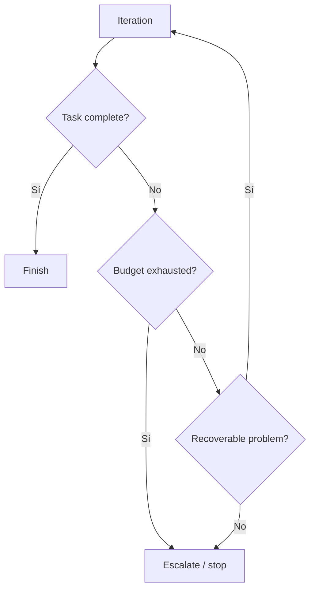

---

# 12. Termination Condition vs `stop_reason`

## Termination condition

Policy de tu system.

Ejemplos:

- task complete;
- max turns;
- too many failures;
- authorization boundary;
- user cancellation.

## `stop_reason`

Metadata de una **model response**.

🔴 **EXAM CRITICAL**

No son sinónimos.

---

# 13. Hard limits

No dependas únicamente de:

```text
"Please stop after 10 turns."
```

Para una invariant real:

```python
MAX_TURNS = 10

for turn in range(MAX_TURNS):
    ...
```

### Principio

```text
Prompt
= guidance

Programmatic control
= enforcement
```

---

# 14. Progress vs Spinning

## Progress

Cada iteration aporta una observation nueva que reduce el gap al goal.

```text
search
→ evidence
→ identify gap
→ refined search
→ answer
```

## Spinning

Actividad sin progreso.

```text
same tool
→ same arguments
→ same error
→ retry
→ same error
```

### Signals

- repeated tool + same params;
- nearly identical observations;
- same failure repeated;
- token use grows but state does not improve.

---

# 15. Retry vs Escalation

## Retry

Útil cuando:

- error is recoverable;
- different params may work;
- existe new information;
- hay otra strategy viable.

## Escalation

Útil cuando:

- falta authorization;
- falta información humana;
- hace falta judgment;
- action is high consequence;
- retry threshold reached;
- no meaningful progress.

🟠 **IMPORTANT**

> Escalation no es “failure”. Es un safety/reliability path diseñado.

---

# 16. Workflow Patterns

Anthropic describe cinco patrones muy útiles.

## Prompt Chaining

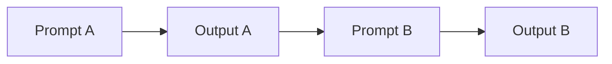

## Routing

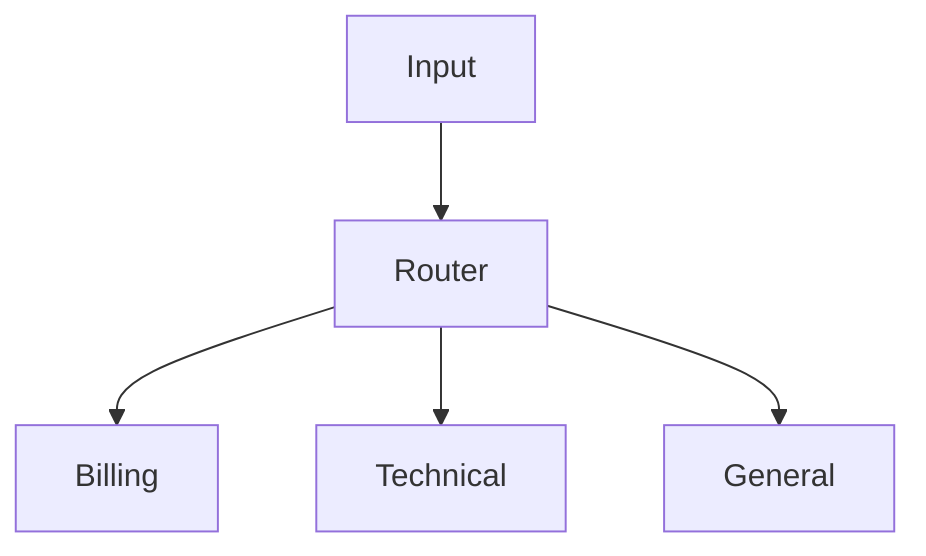

## Parallelization

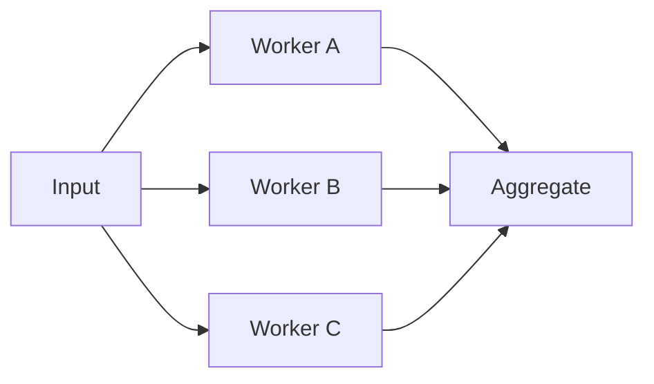

## Orchestrator–Workers

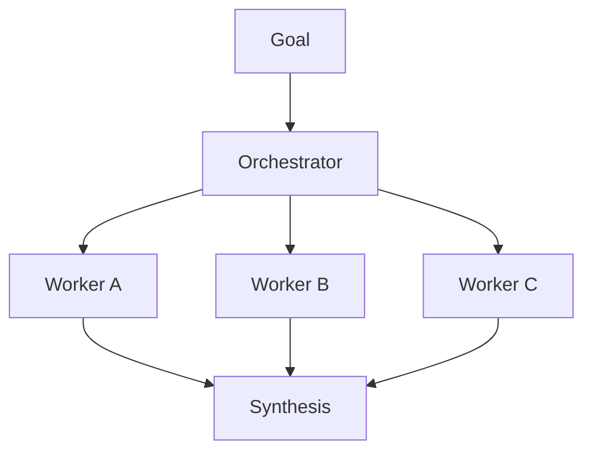

## Evaluator–Optimizer

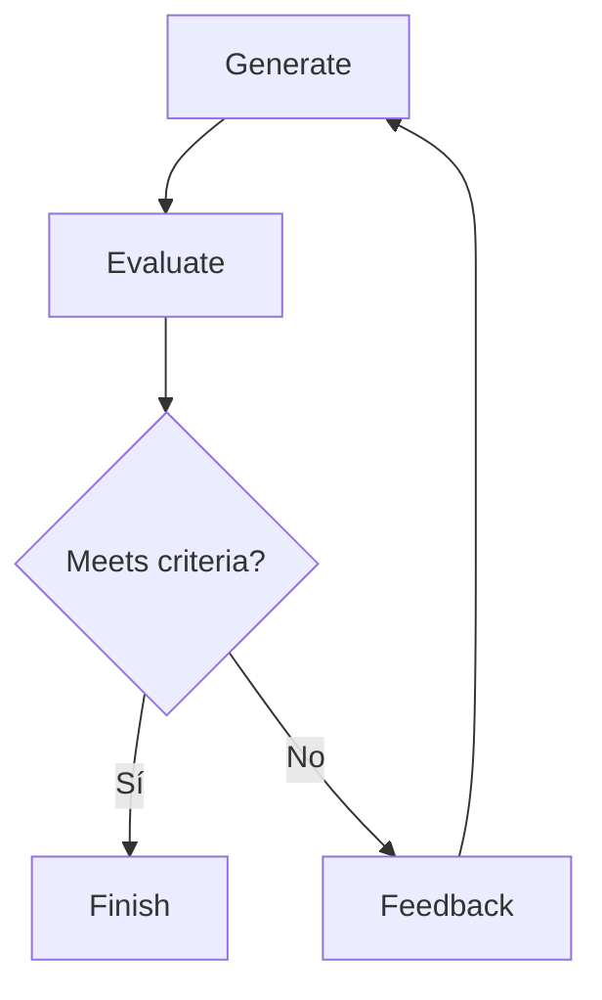

---

# 17. ¿Workflow o Agent?

## Workflow signals

- predictable input;
- known output schema;
- steps can be authored at design time;
- known branches/fallbacks;
- strong auditability need;
- dynamic judgment adds little.

## Agent signals

- open-ended goal;
- unpredictable tool sequence;
- dynamic replanning;
- environment uncertainty;
- intermediate results change the route.

---

# 18. Hybrid Architecture

Es frecuente que la respuesta correcta no sea un extremo.

Ejemplo:

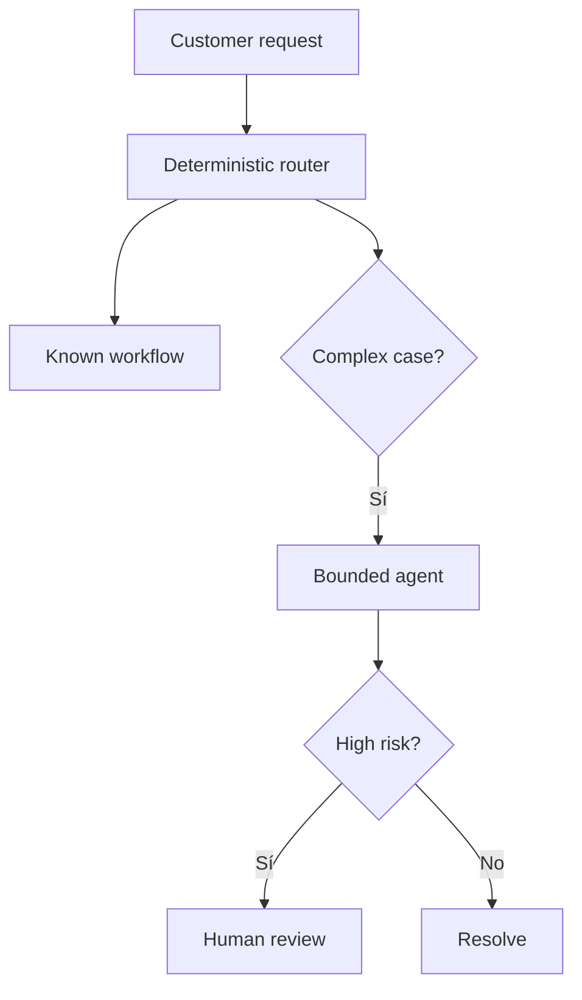

La autonomy queda aislada donde aporta una capability concreta.

---

# 19. Trade-offs

| Axis | Workflow | Agent |
|---|---|---|
| Control flow | predetermined | dynamic |
| Cost | more predictable | more variable |
| Latency | usually lower | usually higher |
| Auditability | stronger | harder |
| Flexibility | lower | higher |
| Failure surface | narrower | broader |
| Replanning | limited | strong |

---

# 20. Una inconsistencia de la transcripción

En `Choosing the Right Architecture`, la lecture mezcla cuatro preguntas donde `yes` no apunta siempre a la misma arquitectura.

No memorizar una regla numérica.

Usar esta matriz:

| Pregunta | Workflow signal | Agent signal |
|---|---|---|
| ¿Steps predefinibles? | **Sí** | No |
| ¿Output specified/testable? | **Sí** | No / open-ended |
| ¿Dynamic tool selection necesaria? | No | **Sí** |
| ¿Dynamic replanning necesaria? | No | **Sí** |

Resultado:

```text
mostly workflow signals
→ workflow

mostly agent signals
→ bounded agent

mixed
→ hybrid
```

---

# 21. Exam Traps

### Trap 1
`LLM = agent`

Falso.

### Trap 2
`prompt chaining = agent`

Falso si el sequence es developer-authored.

### Trap 3
`tool_use = function executed`

Falso para client tools.

### Trap 4
`prompt instruction = hard enforcement`

Falso.

### Trap 5
`retry > escalation`

Falso.

### Trap 6
`end_turn = business success`

Falso.

---

# 22. Ejemplo end-to-end

User:

> “Investigá tres proveedores y recomendá el que mejor cumple nuestros requisitos.”

Un workflow fijo podría no saber:

- cuántas fuentes consultar;
- qué información faltará;
- cuándo una fuente contradice otra;
- qué nueva búsqueda hacer.

Un bounded agent puede:

```text
goal
↓
search provider A/B/C
↓
observe missing data
↓
refine search
↓
compare evidence
↓
detect conflict
↓
fetch additional source
↓
synthesize
↓
finish / escalate
```

Pero incluso acá:

- max turns;
- allowed tools;
- cost budgets;
- side effects;
- escalation;

deben seguir controlados por código/runtime.

---

# 23. Summary end-to-end

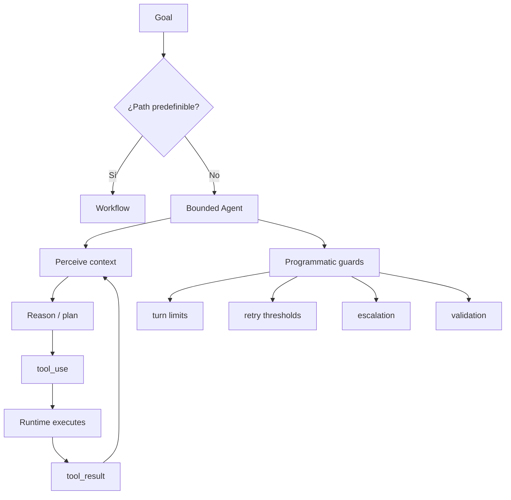

La idea central es:

> **Agentic capability = model-driven decisions + tools + feedback.**

Pero una arquitectura confiable necesita además:

> **deterministic controls alrededor del probabilistic model.**

Y antes de agregar autonomy:

> **preferir la solución menos compleja que realmente resuelva el task.**

---

# 24. Preguntas

### 1. Un sistema ejecuta `extract → classify → summarize`, usando Claude en los tres pasos. ¿Es necesariamente un agent?

<details>
<summary>Ver respuesta</summary>

No.

Si el sequence fue definido por el developer at design time, es un **workflow**.

</details>

### 2. ¿Qué característica define mejor el comportamiento agentic?

<details>
<summary>Ver respuesta</summary>

Que el model participe en la selección dinámica de next actions en función del current context y de intermediate results.

</details>

### 3. ¿Qué papel cumple `tool_result`?

<details>
<summary>Ver respuesta</summary>

Devuelve al model la observation resultante de la ejecución de una tool, permitiendo que esa información influya en la siguiente iteration.

</details>

### 4. ¿Dónde debería imponerse un max-turn limit fuerte?

<details>
<summary>Ver respuesta</summary>

En el **runtime/orchestration layer**, no únicamente en un natural-language prompt.

</details>

### 5. ¿Cuándo retry puede ser mala decisión?

<details>
<summary>Ver respuesta</summary>

Cuando no existe nueva información ni una estrategia diferente y el system empieza a repetir la misma acción/error. Eso puede convertirse en **spinning**.

</details>

### 6. ¿Cuándo un workflow debería preferirse a un agent?

<details>
<summary>Ver respuesta</summary>

Cuando el input/output y los processing steps son suficientemente predecibles para definir el control flow de antemano y la autonomy no aporta una capability necesaria.

</details>

### 7. ¿Qué arquitectura usarías si 90% de los casos son predecibles y 10% requieren investigación dinámica?

<details>
<summary>Ver respuesta</summary>

Una **hybrid architecture**: workflow para el path común y un bounded agent para los casos donde la dynamic investigation realmente aporta valor.

</details>

---

# 25. Fuentes

## Curso backbone

Jacob Bushong — *Claude Certified Architect (CCAR-F) - 2026 Exam Prep*  
Section: `D1: Agentic Architecture - Foundations`

## Anthropic

- Building effective agents  
  https://www.anthropic.com/engineering/building-effective-agents
- Writing effective tools for agents — with agents  
  https://www.anthropic.com/engineering/writing-tools-for-agents
- Tool use documentation  
  https://platform.claude.com/docs/en/agents-and-tools/tool-use/overview
- Define tools  
  https://platform.claude.com/docs/en/agents-and-tools/tool-use/define-tools
- Handling stop reasons  
  https://platform.claude.com/docs/en/build-with-claude/handling-stop-reasons

## Nota de trazabilidad

Este capítulo no reproduce la transcripción. Resume, reorganiza, explica y complementa los conceptos técnicos aprendidos en la sección.
