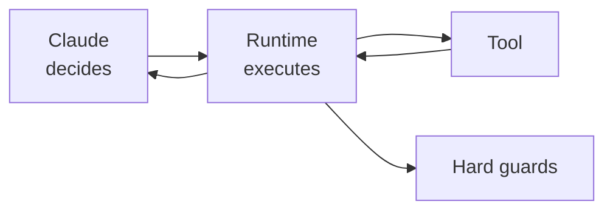

# Lab 1 — Del chatbot al primer Agentic Loop

[← BitSupport Lab](../README.md) · [Volver al Capítulo 2](../../02-agentic-architecture-foundations/README.md)

---

En el capítulo 2 vimos que un LLM no ejecuta nuestras funciones por arte de magia.

Vamos a comprobarlo.

El objetivo de este lab es ver, sin abstraer demasiado, el ciclo:

```text
model decides
→ tool_use
→ runtime executes
→ tool_result
→ model observes
→ next decision
```

---

# 1. Qué vamos a construir

BitSupport recibirá:

> “¿Cuál fue el estado del último deploy de payments-api en QA?”

Tendrá una única tool:

`get_deployment_status`

Por ahora no vamos a conectarnos a un CI real. Usamos datos ficticios para poder concentrarnos en el loop.

---

# 2. Preparar el entorno

Python 3.11+ recomendado.

```bash
python -m venv .venv
```

Activá el virtual environment.

Instalá:

```bash
pip install anthropic
```

Configurá la API key y un model disponible en tu cuenta según tu sistema operativo:

```text
ANTHROPIC_API_KEY=<tu-api-key>
CLAUDE_MODEL=<model-id-vigente>
```

Usamos una variable para el model porque los model IDs cambian con el tiempo. Consultá la documentación oficial vigente antes de ejecutar el lab.

> No subas API keys al repositorio.

---

# 3. Ejecutar

Desde esta carpeta:

```bash
python bit_support.py
```

---

# 4. Antes de mirar el código

Intentá anticipar quién hace cada cosa.

| Acción | ¿Claude o Python/runtime? |
|---|---|
| decidir si necesita la tool | ? |
| elegir los arguments | ? |
| ejecutar `get_deployment_status` | ? |
| imponer `MAX_TURNS` | ? |
| interpretar el resultado | ? |

<details>
<summary>Ver respuesta</summary>

| Acción | Responsable |
|---|---|
| decidir si necesita la tool | Claude |
| elegir los arguments | Claude, restringido por schema/instructions |
| ejecutar la función | Python/runtime |
| imponer `MAX_TURNS` | Python/runtime |
| interpretar el result y decidir qué sigue | Claude |

Ésta es exactamente la separación que necesitamos entender para CCAR-F.

</details>

---

# 5. Qué mirar mientras corre

El programa imprime:

```text
Turn 1: ...
Tool requested: ...
Tool result: ...
Turn 2: ...
Final answer: ...
```

No mires solamente la respuesta final.

Mirá el **control flow**.

---

# 6. 🧪 Probalo vos

## Ejercicio A — cambiá el resultado

Modificá el fake deployment para que el status sea `success`.

¿Claude adapta la respuesta?

## Ejercicio B — agregá un environment inválido

Intentá provocar un caso que tu código no contemple.

Pensá:

> ¿qué debería devolver una tool cuando algo falla?

No resolvamos todavía todo el error handling. Lo vamos a estudiar con más profundidad.

## Ejercicio C — reducí el budget

Poné:

```python
MAX_TURNS = 1
```

¿Qué pasa?

El objetivo es comprobar que el límite vive **fuera del model**.

---

# 7. 🧩 Challenge

Agregá una segunda tool ficticia:

```text
get_service_owner(service)
```

Después preguntá:

> “¿Falló payments-api en QA? Si falló, decime qué equipo debería revisarlo.”

No programes el orden de las tools.

Dejá que Claude decida si necesita la segunda.

Después preguntate:

> ¿el sistema sigue siendo un workflow fijo o ahora el model participa en el control flow?

---

# 8. Qué aprendimos realmente

El resultado más importante del lab no es el código.

Es esta separación:



Claude aporta reasoning.

El runtime aporta execution y enforcement.

Esa combinación será la base de todo lo que agreguemos a BitSupport.
