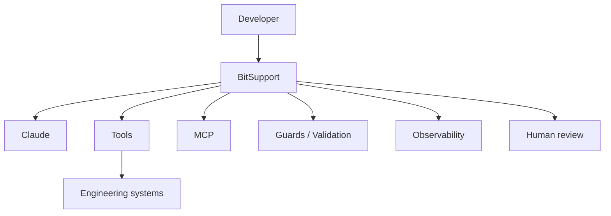

# BitSupport Lab — proyecto transversal

[← Volver al inicio](../README.md) · [Roadmap](../ROADMAP.md)

---

Este laboratorio acompaña toda la guía.

La idea es construir **un único sistema** e ir evolucionándolo a medida que aparecen conceptos nuevos.

No buscamos un producto ficticio perfecto. Buscamos un entorno donde cada tema de CCAR-F tenga una consecuencia visible en arquitectura y código.

---

# El problema

BitSupport es un asistente interno para un equipo de software.

Un developer puede preguntarle cosas como:

- “¿Falló el último deploy de este servicio?”
- “¿Quién es el owner?”
- “¿Hay documentación sobre este error?”
- “Investigá por qué este servicio está degradado.”
- “Revisá este cambio y decime qué podría romperse.”

Al comienzo BitSupport sólo conversa.

Al final del recorrido queremos que pueda trabajar con:

- tools;
- runtime control;
- planning;
- subagents;
- MCP;
- Claude Code;
- structured outputs;
- context management;
- validation;
- retries;
- human review;
- observability.

---

# Arquitectura: la vamos a construir, no asumir

No empezamos con esta arquitectura terminada.



Cada flecha tendrá que ganarse su lugar durante el libro.

---

# Roadmap del laboratorio

| Etapa | Qué agregamos | Capítulo |
|---:|---|---|
| 0 | mental model y proyecto | Capítulo 0 |
| 1 | primera tool + agentic loop + hard limit | Capítulo 2 |
| 2 | task decomposition y planning | Capítulo 3 |
| 3 | coordinator y subagents | Capítulo 4 |
| 4 | retries, fallbacks, validation y HITL | Capítulo 5 |
| 5 | tool design más robusto | Capítulo 6 |
| 6 | MCP server/client | Capítulos 7–8 |
| 7 | Claude Code workflows | Capítulos 9–12 |
| 8 | prompts y structured output | Capítulos 13–15 |
| 9 | context, memory y reliability | Capítulos 16–19 |
| 10 | integración final y review | Capítulo 20 |

---

# Cómo trabajar con el lab

No copies el código y sigas adelante.

En cada etapa:

1. ejecutalo;
2. observá qué parte controla Claude y qué parte controla Python;
3. cambiá algo;
4. provocá un error;
5. explicá qué pasó;
6. recién después seguí.

La intención es transformar:

```text
"entiendo la definición"
```

en:

```text
"vi el mecanismo y sé dónde vive cada responsabilidad"
```

---

# Etapas disponibles

## ✅ Etapa 1 — Del chatbot al agentic loop

👉 [Abrir Lab 1](01-agentic-loop/README.md)

Vamos a implementar una tool simple para consultar el estado de un deployment y recorrer manualmente:

```text
Claude
→ tool_use
→ Python/runtime
→ tool execution
→ tool_result
→ Claude
```

También agregaremos un hard turn budget.

---

# Próximo paso

Cuando esté disponible el capítulo **Task Decomposition & Planning**, el mismo proyecto crecerá.

No vamos a descartar lo construido.

Vamos a refactorizarlo para que BitSupport pueda transformar un goal amplio en subtasks.
